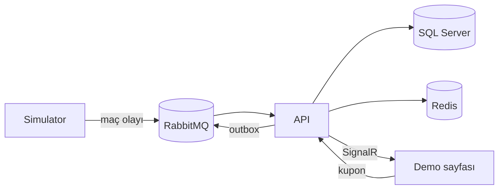

# LivePulse

Sentetik maç olayları üreten, oranları gerçek zamanlı güncelleyen ve kuponları güncel orana göre doğrulayan bir backend projesi. Gerçek spor verisine veya bahis platformuna bağlanmaz.

## Demo

<!-- Videoyu GitHub'da bu satırın altına sürükle-bırak -->

## Nasıl çalışır?



- Simülatör gol ve kırmızı kart olayları üretir, RabbitMQ'ya bırakır.
- API olayı işler, oranları günceller (SQL Server'a kaydeder, Redis'e yazar) ve SignalR ile sayfaya iletir.
- Kupon gönderilirken istemcinin gördüğü oran Redis'teki güncel oranla karşılaştırılır; fark varsa `409` döner.
- Aynı anda 3 maç oynanır. Biten maçın yerine sıradaki başlar, 12 maç bitince sezon baştan kurulur.

## Mimari

Clean Architecture, bağımlılık yönü: `Api / Simulator → Infrastructure → Application → Domain`.

| Proje | Sorumluluk |
| --- | --- |
| `Domain` | Maç, oran ve kupon kuralları |
| `Application` | CQRS komut/sorguları ve port arayüzleri |
| `Infrastructure` | EF Core, Redis, RabbitMQ, outbox, OpenTelemetry |
| `Api` | Controller'lar, SignalR hub'ı, background service'ler, demo sayfası |
| `Simulator` | Maç olayı üreten worker |

Tasarım kararları: kupon ve mesajı aynı transaction'da kaydeden **outbox**, tekrar eden istekleri engelleyen **Idempotency-Key**, kupon anında yapılan **oran doğrulaması** ve RabbitMQ üzerinden taşınan **OpenTelemetry** trace'i.

## Teknolojiler

.NET 10, ASP.NET Core, SignalR, EF Core, SQL Server, Redis, RabbitMQ, OpenTelemetry, xUnit, Testcontainers, Docker Compose, k6

## Çalıştırma

```bash
docker compose up --build -d
```

| Ne | Adres |
| --- | --- |
| Demo sayfası | http://localhost:8085 |
| Swagger | http://localhost:8085/swagger |
| RabbitMQ paneli | http://localhost:15672 (guest / guest) |
| Aspire Dashboard | http://localhost:18888 |

Endpoint'ler: `GET /api/matches`, `POST /api/coupons` (`Idempotency-Key` header'ı gerekir), `GET /api/coupons/{id}`.

## Testler

```bash
dotnet test
```

Entegrasyon testleri Testcontainers kullanır, Docker açık olmalıdır. Yük testi için: `k6 run k6/load-test.js`
